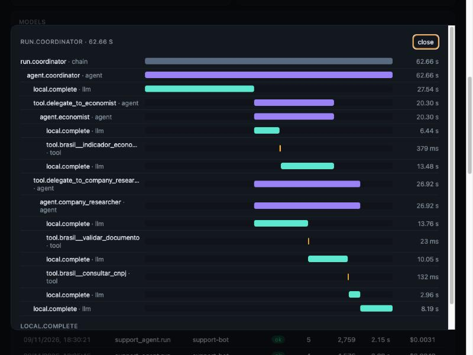
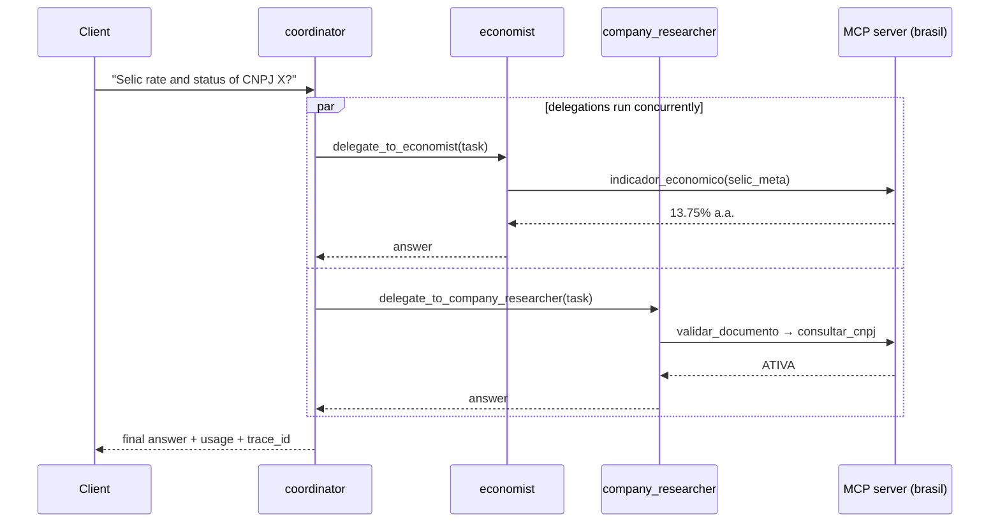

# agent-orchestrator


A multi-agent orchestration API. Agents are declared in YAML, get tools from Python functions
or any [MCP](https://modelcontextprotocol.io) server, and hand work to each other through a
supervisor → worker pattern. Every run is traced end to end.

No agent framework underneath: the loop is ~150 lines you can read in one sitting, so it's
easy to reason about failure modes, cost and latency.



*A real run on a local `qwen3.5:9b` (Ollama): the coordinator delegates to two specialists
**in parallel**, which call tools from [mcp-server-brasil](https://github.com/vicgamelo/mcp-server-brasil).
Trace shown in [genai-lens](https://github.com/vicgamelo/genai-lens).*

## Features

- **Supervisor / worker delegation.** Delegates become tools (`delegate_to_<agent>`); a worker
  starts with a clean context containing only its sub-task, so the supervisor has to write
  self-contained instructions (and you can test each worker in isolation).
- **Parallel tool calls.** Independent calls from the same model turn, delegations included,
  run concurrently with `asyncio.gather`.
- **MCP native.** Connect servers over Streamable HTTP or stdio; tools are namespaced
  `<server>__<tool>` and can be granted one by one or with `server__*`.
- **Provider-agnostic.** Anthropic, OpenAI, or anything OpenAI-compatible (Ollama, vLLM,
  LM Studio, Groq...). Mix them: Claude as the coordinator, a local model for workers.
- **Guardrails.** Max steps per agent, per-tool timeout, run timeout, delegation depth and a
  token budget shared by the whole run. Tool errors are returned to the model, which can recover.
- **Observability.** Nested spans (run → agent → LLM call / tool → delegated agent) exported
  to genai-lens; streaming events over SSE.
- **Sessions.** Pass a `session_id` to keep multi-turn conversation history.

## How a run works



## Quickstart

```bash
uv sync --all-extras
ollama pull qwen3.5:9b                      # or set COORDINATOR_PROVIDER=anthropic + ANTHROPIC_API_KEY
uv run agent-orchestrator                   # reads agents.yaml, serves on :8000

curl -s localhost:8000/v1/runs -H 'content-type: application/json' \
  -d '{"input": "Qual a meta Selic atual e a situação do CNPJ 00.000.000/0001-91?"}'
```

Streaming:

```bash
curl -N localhost:8000/v1/runs/stream -H 'content-type: application/json' \
  -d '{"input": "Quantos dias úteis tem dezembro de 2026?"}'
# event: agent_start / llm / tool_call / tool_result / agent_end ... / done
```

## Configuration

```yaml
providers:
  local:     { type: openai, base_url: "http://localhost:11434/v1" }
  anthropic: { type: anthropic, api_key: "${ANTHROPIC_API_KEY}" }

mcp_servers:
  - name: brasil
    url: https://mcp.vgmelo.tech/mcp          # or: command: uvx, args: [mcp-server-brasil]

agents:
  - name: coordinator
    provider: anthropic
    model: claude-sonnet-5-5
    delegates: [economist]
    instructions: ...
  - name: economist
    provider: local
    model: qwen3.5:9b
    tools: [brasil__indicador_economico, calculator]
    instructions: ...
```

See [`agents.yaml`](agents.yaml) for the full example. `${VAR}` and `${VAR:-default}` are
expanded from the environment, and references (providers, tools, delegates) are validated at
startup, so a typo fails fast instead of in the middle of a run.

| Env | |
| --- | --- |
| `ORCH_CONFIG` | Path to the YAML (default `agents.yaml`) |
| `ORCH_API_KEYS` | Comma separated keys for `X-API-Key` (empty = open, local dev only) |
| `GENAI_LENS_ENDPOINT`, `GENAI_LENS_API_KEY` | Export traces to genai-lens |

## API

| Method | Path | |
| --- | --- | --- |
| `GET` | `/v1/agents` | Agents, models and their tools |
| `POST` | `/v1/runs` | `{input, agent?, session_id?, include_events?}` → output, status, usage, trace_id |
| `POST` | `/v1/runs/stream` | Same, as Server-Sent Events |
| `GET` | `/v1/runs/{run_id}` | A past run with its events |

## Development

```bash
uv run pytest        # scripted LLM provider + in-process MCP server: deterministic, offline
uv run ruff check . && uv run mypy
```

The test suite uses a `ScriptedProvider` (each agent follows a script of tool calls and
answers), which makes it possible to assert on concurrency, budgets, delegation depth, span
nesting and the exact messages each agent receives.

```
src/agent_orchestrator/
├── agent.py          # the loop, guardrails, delegation tool
├── orchestrator.py   # wiring, sessions, run records
├── mcp_tools.py      # MCP servers → tools
├── tools.py          # function tools, safe calculator
├── tracing.py        # nested spans → genai-lens
├── config.py         # YAML schema + validation
├── api.py            # FastAPI + SSE
└── llm/              # anthropic, openai-compatible, scripted
```

## License

MIT © Victor Gabriel Andrade de Melo
